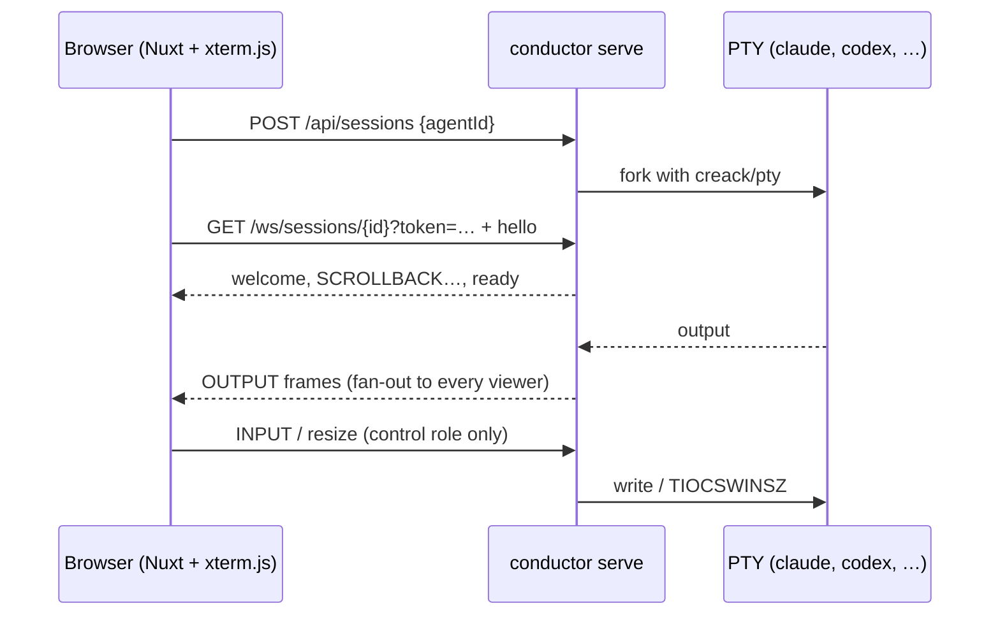
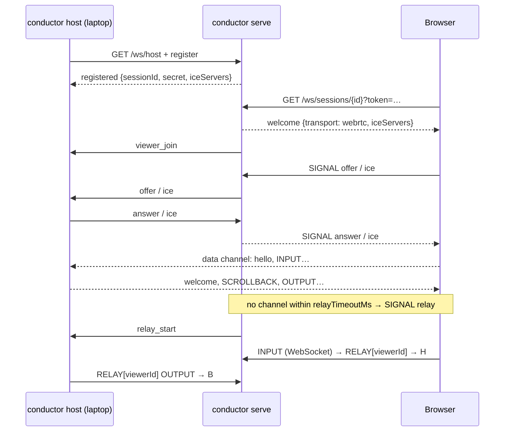

# Architecture

Conductor is one Go binary plus an embedded Nuxt single-page app. It runs in two
roles.

The names follow the railroad. **Conductor** is the application, where people
direct and supervise the work. **Yardmaster** is the agent harness: it manages
the agents' execution, crews, tools, lifecycle and coordination, the managed
runs of #334. **Brakeman**, to come (#356), is the sidekick agent that watches
the work, anticipates problems, summarizes progress and assists the people: an
agent powered by Yardmaster with privileged access to the operation's
telemetry, not a part of the harness. **Switchman**, to come, routes tasks
between agents, crews and people.

## Server-hosted sessions

`internal/session.Local` owns the PTY: a pump goroutine copies output into a
256 KiB ring buffer and broadcasts it to subscribers. Each subscriber has its own
bounded queue; exceeding 1 MiB of backlog evicts it as a slow consumer, and the
client reconnects to get a fresh replay. Each subscriber's own goroutine writes
its frames and then closes its transport; ending a subscriber only marks it,
so a transport that stops taking frames, or takes its time to close, holds up
neither the pump nor anything else under the session's lock. A revoke waits
for the link's viewers' transports to close, all at once, holding no lock.
What was queued for a subscriber is dropped as it ends, but for one the
session's end closes (its link ends with the session): it is written first,
the session's last output and its status, unless its link is revoked or
expires meanwhile or the session leaves the server, and a server cuts a
connection that has not taken it 5 s after the close. A hosted session's
viewers on the server are closed and drained the same way at its end; a
revoke is never drained.

`Local.Submit` is the one way Conductor types into a session (a crew member's
prompt, a handoff, a broadcast) and the way a reply box's `submit` message is
typed: the text, as a bracketed paste while the program has that mode on (the
pump follows `ESC[?2004h`/`ESC[?2004l`), then, 250 ms later, a carriage return
written on its own, one submission at a time per session, with no lock held
across the pause (which, in a session with a trust watcher, lasts until the
watcher has looked at what was drawn since the text), cancellable, and never
written twice. A submission whose link no longer opens the session (revoked,
expired) before its carriage return is written gets none: if its text is
typed, the session's turn stays held (`holdTyped`, attention `source:"submit"`)
until a person's INPUT, or the session's end, so no other line joins the
text. A person's INPUT stays
raw. The same pump treats output that only sets the window title as no output,
watches the screen's text for the agent's workspace-trust question
(`Options.TrustPattern`), and an INPUT that is only a terminal's automatic
reports answers nothing. A session that ends clears its attention as it ends.

## Developer-hosted sessions

The host reuses `session.Local` unchanged; only the sinks differ (a pion data
channel with backpressure, or a relay sink that wraps frames in RELAY envelopes).
Everything the host writes on its control connection goes through one writer
per connection (`hostagent/controlwriter.go`): the host's own messages ahead
of the relayed frames, the relayed viewers in turn, and a socket whose writes
never wait, so the WebSocket library's own time limits (a write's, a ping's
answer) never fire on a server that reads slowly; a relayed viewer whose frame
waits too long for its turn is let go alone, and the connection is given up
only when its socket takes nothing for two minutes.
The server tells the host on that connection when a link goes, in a lane of
the server's own that its writer takes ahead of the frames it relays
(`signal.HostConn`): the link's viewers are closed first, and what of
theirs was still queued is dropped as the writer comes to it, so nothing of
a viewer of a link reaches the host after the link's going. What a viewer
who joined through a link sends (a line, a key, a save, a read, an editor's
open, a chat post) is acted on only while its link stands
(`AttachOptions.Authorize`, which an attach needs alone) and the host
vouches for its server (`AttachOptions.Fresh`; `hostagent/liveness.go`): a
ping of the host's own, sent within 15 s, answered, nothing else counting
(see docs/protocol.md, the host control connection). The host pings as a
viewer joins through a link and every 5 s while such a viewer, or something
of theirs, is there; a first line waits for its join's ping to be answered.
A connection that stops carrying anything without either end closing it,
or whose server pauses its reading for longer than the bound, is then a
link gone for what they send, as a connection lost is, and one the host has
pinged and heard nothing on for two minutes it gives up. The server, for
its part, pings the host every 5 s while a link a viewer joined the session
through stands (`api/ws_host.go`, `hostKeepalive`), for older hosts. The
host's control connection's read loop waits on nothing but the read: a
save's parts and an offer's answer run off it, a save's in a bounded,
ordered queue of the viewer's, as its keys and editor requests do.
A relayed viewer the
server holds more than 512 KiB for, unwritten, is behind (`viewer_behind`):
the host holds its frames until it catches up, as it holds a WebRTC viewer's
while the data channel is full, so the shared connection carries what each
relayed viewer takes.
The server never sees terminal bytes on the WebRTC path and never runs the
command. On the relay path it carries them and can read them; and since it
carries the signalling and tells the host each viewer's role, a host trusts
its server with both.

## Reachability

What each piece does when a link crosses a network boundary:

- **The server** serves the join page, brokers the WebRTC signalling of a
  hosted session (offer, answer, candidates) and relays its terminal channel
  when no direct path forms. Everything a guest does begins with an HTTP
  request to it, so a link works only where the server is reachable.
- **STUN** (the `iceServers`) answers a browser or a `conductor host` with its
  own public address and port, so ICE can try a direct UDP path for the
  terminal channel. It carries no data and does not make an HTTP page
  reachable.
- **TURN** (none configured) would relay the terminal channel through a public
  relay; Conductor's own relay over the host's WebSocket does that job today.
- **A forwarded port, a public address or a proxy** makes the server
  reachable. That, and only that, makes a link open from outside.

Two packages make a machine behind a home router reachable with nothing
configured: `internal/reach` asks STUN for the public address and maps the
TLS port on the router through UPnP IGD, PCP or NAT-PMP (the plain port is
never mapped; the lease is renewed and deleted on shutdown), and
`internal/certs` obtains a certificate from Let's Encrypt through lego for
that address (an IP-address certificate, `tls-alpn-01` on the mapped 443) or
for configured domains, keeps it under `dataDir/tls` and serves it on a
second listener (`tls.listen`), HTTP/1.1 only. The manager serves nothing
before the first issuance. Share links take `https://<public address>/…`
only once the port is mapped and the certificate is ready; until then they
keep the address the request came through. A mapping is reported as
"mapped", never "reachable": the server's own check through the public
address is often refused by the router (no hairpinning), so a person on
another network is the only proof. `conductor serve` wires the three: the
mapper tells the certificate manager the address once the port is mapped,
and the API reads both for `GET /api/reach` and the link base.

Every server publishes its sessions to a switchyard by default (`rendezvous`
in the config: the public `switchyard.rslabs.net`, another one, or off), so
a link works from anywhere whatever is in front of this machine:
`hostagent.Uplink` registers each local session with the public
Conductor over the host control connection, exactly as `conductor host`
does for the process it runs, one connection per session; the rendezvous
lists it as hosted, serves its viewers over WebRTC or its relay, and mints
the links; the local server chains its session hooks to the publication so
attention and activity travel both ways, and ends the publication when the
session leaves.

## Crew runs

A crew run is `internal/crew`'s `Engine`, and every member is an ordinary
server session: the engine starts it through the `Launcher` interface, which
`internal/api` implements with `createLocalSession`, the one path
`POST /api/sessions` takes, so the working-directory check, the catalog
lookup, the environment and the hook injection are the same as for any
session. The session carries its run in `Info.crew`, and its process gets
`CONDUCTOR_CREW`, `CONDUCTOR_RUN`, `CONDUCTOR_MEMBER` and `GOAL`. With
worktree isolation the engine first makes the member's worktree
(`gitcli.AddWorktree`: `git worktree add --no-checkout`, then the checkout
inside the new worktree, so that the configuration its branch and git
directory include is the one looked at; argv, never a shell, through
`gitcli.Run` like every git Conductor runs: command-line configuration turns
off the hooks, the file system monitor, the pager, external diff and text
conversion, the editor, credential helpers, transports and every clean,
smudge and process filter the configuration may name) and starts the member
in its own worktree under
`<cwd>/.conductor/worktrees`; it never removes one. A launch returns once the
sessions exist; a goroutine per member, on the run's own context, then waits
until the session is ready (its agent reports `needs_input` or `done`, or its
output goes quiet, and it is not between two screens of its start), held while
a trust question shows, and submits the role prompt with `Local.Submit`,
stamping the member prompted just before the carriage return. The engine
listens through two hooks that never wait: a sink on the activity fan-out
(`Engine.OnActivity`, beside the webhooks) sees every entry of every session,
starts the `after` members when a member first reports `done` and takes a
member's `handoff` events, and the session change hook (`Engine.OnChange`,
chained after the SSE publish) wakes the handoffs queued for a member when it
leaves `needs_input`: a prompt that is cleared records no entry, only a change.
Handoffs and broadcasts are submitted unless the session waits, a look at the
attention state made in the same step that finds the prompt a write would
answer, and a prompt raised during the pause keeps their carriage return back,
so neither ever answers a prompt. What changes in a run without a session
change (a member reserved, started, prompted or ended, an entry in its log, a
stop) is reported through `Engine.OnRunChange`, under the engine's lock and
without waiting, as a `run` event on `/api/events`, and a forgotten run as one
with `removed`; the browser's live store reads the run again, so no page
polls. A run's state (running, needs input, stopped, finished) is derived each
time it is read. The run log's note of a delivered handoff carries the two
members as fields (`byName`, `to`), which the crew graph on the run page
draws as dashed edges beside the solid "after" edges of the start rules; the
layout is the client's (`web/app/utils/crewGraph.ts`: column by depth in the
forest the rules form, row by crew order), and the editor's graph holds the
same rules as the server (one parent, no self edge, no cycle) before a save. `Engine.ResumeMember` starts an ended member again in its
worktree, resuming its agent's own session through the agent's session recipe
when it can. Runs live in memory, as sessions do;
run links are share-store links scoped to a run (`Link.RunID`), which the
server resolves to the run's member sessions through `Engine.MemberOf`.

A crew with tasks launches a **managed run**, Yardmaster's (#334): the same
engine with its truth in the ledger (`internal/crew/ledger`, one SQLite database per data
directory) instead of memory. `task.go` dispatches each task as an attempt
once the tasks it needs have results: a reservation among the server's
sessions, a worktree at the commit the task starts from (its first need's
result, or the run's base) on the branch `crew/<run>/<task>.<n>`, the task
written into it as `.conductor/task.md` and `task.json`, the worktree made
usable by the crew's project manifest (below), then the member's session
through the same `Launcher` and one typed line saying where the task is and
how to submit. The attempt's
session submits its result with its own token (`POST
/api/sessions/{id}/task/result`, the `task_result` tool or `conductor task
result`): the commit at its HEAD, refused while the tree is dirty or the
commit does not descend from every input. `verify.go` then runs the task's
checks against that commit in a detached checkout through `internal/proc`
(argv, a timeout, the process group ended with the run, the output's head and
tail), one at a time across the server, and the checkout compared with the
commit after each; a failing check fails the attempt and the next one starts
from that commit with what failed in its task file. A review's `needs_changes`
reopens the task it reviewed and withdraws, transitively, whatever rested on
the result. Every transition is one ledger transaction committed before the
side effect it precedes (the reservation before the worktree, the launch
before the session, the typing before the line, a check before its process),
so a crash leaves intents the next start concludes: `ledger.Recover` marks
what was open, the records are rewritten from the ledger, and
`continue.go` makes a continuation of an interrupted run that keeps the
results that stood, verifies a candidate again and dispatches the rest, the
attempts spent before counting against the tasks. A person's commands (pause,
retry, cancel, accept) are `commands.go`'s receipts, written in the change's
own transaction, so a repeated command answers the same receipt. `messages.go`
carries the members' durable messages, typed after the recipient's task line,
and `checkpoints.go` an attempt's blocker and checkpoints, where the next
attempt starts after a session is lost.

A managed crew may carry a **project manifest** (EN1, `manifest.go`): what
makes a fresh tree of the project usable, how it is checked and how it is
cleaned up. It is not an agent's recipes, which are the catalog's. It is
either the crew's own, counted by the server at each change (a receipt names
it `crew:<revision>`), or `conductor.manifest.json`, read at each tree's
commit (`file:<blob>`), so a task that changes it is checked by the manifest
it changed; a crew saved with `setup` runs it as the manifest's setup phase.
A tree is the attempt's worktree or its result's checkout. `steps.go` makes
each one usable before the member's session or the first check rests on it:
the manifest resolved and its host names checked (`env`: only names the
server's `envPassthrough` allows and its environment has), its ports drawn
(`CONDUCTOR_PORT_<NAME>`, leased by the engine until the tree ends), its
state directory made (`.conductor/state`, through an `os.Root`), its setup
steps, its services (`proc.Serve`, under the run's teardown context, never
the attempt's), its readiness probes (a command, or one `GET` on the
loopback with no redirect followed), then `tree.ready` with the preview. The
checkout runs the manifest's verify steps after the task's checks. The
prerequisites run once per run in the crew's directory before the first
attempt, and again at each unpause. Every step goes through the tree's
executor (`treeExec`: `internal/proc` natively) and is a receipt: a `checks`
row with its phase (a `prerequisites` row for a prerequisite) holding its
command, directory, manifest, exit, timing, words, log and SHA-256, read
through `GET /api/runs/{run}/tasks/{task}/attempts/{n}/steps` and `GET
/api/runs/{run}/prerequisites` with their logs, from the ledger, so a run
the engine has let go reads the same. A step that fails in a tree the agent
has not touched is the host's or the manifest's: the attempt is not
counted, the task says which step failed, and the dispatch pauses with the
words (`pausedWhy`); one that fails in the checkout of a result is the
result's, counted as a failing check is. However a tree ends (a result
taken, a check failed, a cancel, a withdrawal, a stop, the server's
shutdown), `endTree` waits for it to be quiet, stops its services, runs its
cleanup steps, releases its ports and records `tree.ended`; nothing removes
the tree itself. A stop ends the run's services beside its sessions before
`recordStop`, and the server's shutdown arms a cut-off first
(`Engine.Draining`) so the teardown fits its budget; a service a crash left
running is reported at the next start, never signalled. The run page shows
the receipts under each attempt (`RunAttemptSteps.vue`) and the
prerequisites above the tasks, the header's `paused` badge with its words
and `cleaning up` while trees end, and Open preview on the task's row and
in the palette while the attempt's `preview` is set: a new tab, since the
preview is on the server's loopback, not proxied, and an iframe of it would
be mixed content under TLS.

## Dispatch

Dispatch is a component, Conductor's own work tracking: projects, tickets
with stable keys (`CND-12`), their discussion and their history
(`docs/plans/dispatch.md`). It is not the engine's verb: the engine
dispatches a managed run's tasks as attempts (`task.go`, above), which
the pages and the run log call scheduling, and that stays Yardmaster's.
Dispatch records what was asked for and what became of it; it starts no
process, opens no session and runs no check, and links to a run the
engine made rather than copying it, so the ledger stays the truth of
execution.

`internal/dispatch` is the store, with no HTTP: one SQLite database of its
own (`modernc.org/sqlite`, as the ledger's), opened by the server beside
the ledger with the ledger's pragmas and one connection, and no owner
lock: SQLite's own locking orders writers across processes, and the
schema is made inside the transaction that read its version. Every write
is a typed operation (`Apply`), one `BEGIN IMMEDIATE` transaction that
looks up the receipt kept under the actor and the op id the client
minted, compares the revision the client expects, makes the change with
one `changes` row per field it set, added or removed, bumps the entity's
`rev` once, keeps the receipt and commits, so a reply lost to the network
is asked for again with the same id and never makes a second change; a
refusal of the store's rules is a failed receipt kept alone. The
`changes` log is a ticket's history, and what replication (CS1) will ship
between replicas, merged by the field rules of `rules.go`. A read of more
than one statement (a ticket with its sets, comments, links and close
state; a list and its total) is one read transaction, so a reply
describes one state whatever commits meanwhile. The store's one sight of
the engine is `RunExists`, which the server gives it: a run link names a
run the engine holds or has a record of. A ticket's attachments are files
beside the database, one per content, named by its SHA-256
(`attachments.go`): an upload writes and hashes its file, holds the hash
with a lease (an `uploads` row) committed before the file is published
under it, and writes the row naming it, the lease dropped in the same
transaction, only once the file's new name is durable (on unix its shard
and then `attachments/` synced, on Windows the move written through). The
sweep at open (`sweep.go`) is the one thing that deletes a file: it drops
the leases older than an hour in a transaction committed before any
unlink, then deletes the files no live row and no lease names, under a
write lock it holds while it does, so an upload paused across another
server's sweep either finds its file named or is refused `expired`.

`internal/api`'s `dispatch.go` puts the store on the HTTP API: the admin's
routes alone, a switchyard's 403 (it opens no store), each write's body
an operation with its receipt in the reply, and replies written with HTML
escaping off, so the largest is bounded by its shape. After every commit,
outside the transaction and on the writer's goroutine, the store's
`OnChange` hands the server what the commit changed in one call, a
change per entity, and the event hub sends the browsers a `dispatch`
event for each, but one for more than 64 of a kind in a project, naming
none of them (a page re-reads what it shows of the project), the
commit's together as one entry of a client's queue, by the `run` event's
path: a client that cannot keep up is dropped and starts over from a
snapshot, never for one commit's size, and no webhook or sink sees it.

## Switchyard

A switchyard is the server in a mode (`config.Switchyard`): the signaling
hub, the host route, the share links, the join route, the events stream and
the workbench, with the launching routes answering `403 switchyard` and no
catalog or agents needed. Other Conductors publish their sessions to it
through the host protocol (`rendezvous`), `conductor host` does the same,
and viewers join by links minted there; the terminal goes over WebRTC
between the viewer and the publisher, through the switchyard's relay only
when ICE fails and the relay is on (`switchyard.relay`). The desktop app's
workbench, served from a loopback address, may join from its own page: the
join route answers the switchyard's allowed origins across origins and the
session WebSocket accepts them. What a switchyard carries is signaling and
the relayed terminals, so one small machine with a certificate serves many.
It is trusted with what is published to it: it mints and checks the links
and tells the publisher each viewer's role. A Conductor publishing there
(`hostagent.Options.Switchyard`, which the Uplink sets) tells it less: each
session's name, agent, folder's last element and machine name, status and
attention state, no chat or activity; takes no report from it; and ends the
publication, not the process, on its stop. In switchyard mode the workbench
token lists the published sessions and has no role on them
(`principal.yard`).

Its pages are its own (`internal/api/switchyard_page.go`): a server-rendered
landing page at `/` (what the server is, how a link looks, how a machine
publishes to it, a status card from the same facts as health, reach and the
certificate manager, and the operator's figures behind the workbench token
through `GET /api/switchyard/status`), a 404 page for every workbench path,
and the app only under `/join/` and `/paste` and for its assets. The pages
are Go templates with the brand tokens inlined, so a switchyard built
without the UI still answers. A `relayMeter` counts the bytes the relay
carried over the last hour for the operator's card.

## Desktop shell

`desktop/` is an Electron shell around the same binary: it starts
`conductor serve --listen 127.0.0.1:0 --print-listen --exit-on-stdin-close`
with the settings it keeps (`userData/settings.json`: data directory,
allowed roots, default directory, yolo, reach) as `CONDUCTOR_*` variables,
a workbench token minted for the run in the environment, and the login shell's
PATH so the agents are found; reads the handshake line from stdout; opens the
workbench in a window whose preload exposes the token through a
context-isolated bridge (`window.conductorDesktop`); polls the server's
health and restarts it with backoff; and stops it by closing its stdin when
the app quits. Navigation stays on the server's origin, other links open in
the system browser, and "Open in browser" carries the token in a URL
fragment the workbench takes and drops. On Windows the shell runs the Linux
binary inside a WSL 2 distribution. `desktop/README.md` has the layout.

On Windows the shell also runs a UDP forwarder in front of the server in
WSL (its default NAT mode left as it is): one port on Windows, each remote
peer carried to the distribution on a socket of its own, the server
advertising the Windows address (`ice.udpPort`, `ice.publicIp`). The shell
registers the `conductor:` scheme: an invite opens its own join page with
`?server=`, which signals to the switchyard named.

## Extensions

Conductor is open core: a paid feature is a provider that another module's
`main` compiles in (package `ext`), backed by a hosted service. This
repository holds the interfaces, their free defaults (`ext/local`) and the
seams that call them; a plain build registers nothing.

**The registry and the composition root.** A provider registers in its
package's `init`. `runServe` and `runHost` (`internal/cli`) are the
composition root: each reads the registry once, at start, through the
package variable `extensions` (`ext.Freeze`, which closes it, so a
`Register` after it panics and no provider appears mid-run; a test
replaces the variable and never registers into the process's registry).
`runServe` fills every empty slot with its free default (`local.Fill`,
the one place any code asks whether a provider is registered), logs one
info line naming what is registered (`extensions: identity cloud,
notifications push`; a plain build logs nothing of it), and hands the set
to `api.New` through `api.WithExtensions`. `New`'s options are read before
it writes anything (the masked `catalog.json`, the crews' migration, the
ledger's recovery), and a server made without the option holds
`local.Fill(ext.Providers{})`, the free build. `runHost` closes the
registry and uses nothing of it until the Runtime seam.

**The guard.** `New` wraps every provider in the guard
(`internal/api/extensions.go`), defaults included, so no seam tells a
default from a provider. A direct call goes through `extCall`: it runs
within the interface's wait (`IdentityWait` 1 s, `RouteWait` 5 s,
`ContextWait` 5 s, `ICEWait` 2 s), on a goroutine of its own whose context
ends with the wait or the caller's, and answers the free default's answer
when the call errs, panics, answers what the record's `Valid` refuses, or
has not answered in time (its late answer is never used; its goroutine
finishes on its own). At most 16 calls of one provider and kind run at
once (`extInFlight`); past it the default is answered at once, so a
provider that hangs holds 16 goroutines of a kind at most. The check of
an answer runs on that goroutine too, inside the wait and the slot, since
its cost is the provider's answer's. What it checks and answers is its own
copy of the provider's answer, and the provider is given a copy of what it
is asked about, made before the call's goroutine begins (a caller answered
the default may reuse its slices at once), so a provider that changes a slice it answered or was
given changes nothing a seam holds nor what its answer is checked against;
a provider's error or panic text is read on the call's goroutine, a panic in it
recovered, and the caller runs no method of the provider's. Each provider
is named as the registry named it (`Providers.All`), so `New` asks no
registered provider anything. A failure is
logged at warn once a minute per provider and kind, with how many failed
since; nothing else about it is kept, so the next call after an outage is
answered as if none had happened, with no restart. A wait bounds a hang,
never a normal answer: a provider answers from what it holds.

**Queues.** The calls fed from the server's own activity (`Notify` to a
notification sink, `NoteTouch` to a context provider) go through an
`extQueue`: a ring per provider and kind (`SinkQueue` 256, `TouchQueue`
1,024) filled without waiting, a full ring dropping its oldest (the first
drop and every hundredth logged, as a webhook's queue does), drained in
order by one goroutine of its own, each delivery with a context that ends
after `DeliveryWait` (10 s), its panic recovered. A provider that is no
`ext.Starter` drains once `New` can no longer fail, so a `New` that fails
leaves no drain running; a Starter's queues hold what reaches them until
its `Start` has succeeded. `Saved`, `Deleted` (sync) and `Resolved`
(decisions) never go through a ring, since a call they lose is never made
again: they are delivered the same way from lists that drop nothing (C6,
C5). `Shutdown` ends the drains with the webhooks, what waits in them
undelivered, and waits for their goroutines with its others (`track`).

**Host and Start.** A provider that needs the server is an `ext.Starter`.
`runServe` calls `Server.StartExtensions` once the server is made, its
switchyard publisher set, and before the listeners serve, with the
maintenance context; it asks no provider anything itself and returns at
once. `conductor host` starts none. It calls `Start` once per distinct registered value
that is a Starter (one value in two slots is started once; one registered
only as the entitlement source is started too), all at once, each try
with a context and an `ext.Host` of its own (`internal/api/exthost.go`).
Until a provider's `Start` has succeeded, every slot it holds answers its
free default without asking it, its queues hold what reaches them, and
it is `starting`. A try that errs, panics or has not returned within
`StartWait` (5 s) is logged as the guard logs a failure (kind `start`)
and given up: its context is cancelled, which revokes its `Host` (every
call then answers `context.Canceled`, and one under way, waiting for a
session's turn or a launch not yet handed to the engine, ends with it, so
goroutines a given-up try began cannot act). A submission's withdrawal is
the try's end itself (`session.Submission.Withdrawn`, looked at as the
writer takes the text), never a context passed on later, and it does what
a revoked link does: a line whose text is typed has its Enter left out and
the session's turn held for a person, a reply's claim let go as the hold
shows. The next try begins after a
backoff of 1 s doubling to 5 minutes, for as long as the server runs, and
only once the last try has returned: a `Start` that ignores its context
holds one goroutine, logged as late once a minute, and nothing calls it
again meanwhile; its late answer is ignored. Once a try
succeeds its slots are the provider's from their next call and its
queues drain, with no restart; the try's context ends with the server.

The `Host` is the provider's only door into the app. `Launch` validates
the request (a crew id, a label, a principal) and runs what `POST
/api/crews/{id}/launch` runs (`launchSaved`: the label, the crews store,
the managed checks, `Launchable`, `checkLaunch`, `resolveCwd`, the yolo
choice, then the engine's `LaunchNamed`), notes "launched by <name>
through <provider>" in the run's log and answers the run's id, crew and
page URL on the public base; a switchyard and a server with no data
directory answer `ErrUnsupported`, a crew not held `ErrNotFound`, a
refusal `ErrRefused` with the route's words. `Submit` types a line into
a server session only while it shows no question (`Local.Submit` with
`UnlessWaiting`), or answers a question with a line through the
question's claim, as a viewer's reply does (`ErrQuestionAnswered` once it
no longer waits), or with a choice's keys (`Local.AnswerAs`: only one
of the question's own choices, through the same claim; keys whose write
has begun when the call ends answer `pending`, as a line does, and keys
still queued when the try is given up are withdrawn); a hosted session
answers `ErrUnsupported` until its hosts take routed answers, and a line
blank once cleaned is refused (it would be a bare Enter). `Notify` checks a
notice (500 bytes of message, 2,048 of URL, one line each) and types it
`provider` from its sender; a provider one of whose sinks lists
`TypeProvider` (read once, from `Events`, on the provider's own goroutine
before its first `Start`, so a slow sink holds up nothing else) may not
send one (`ErrUnsupported`), so notices never loop between providers;
the sinks that list `TypeProvider` are handed it (Notifications, below). `DataDir` is
`<dataDir>/ext/<name>`, made 0700 through the store. `Log` is the
server's logger naming the provider.

**Identity.** The identity provider is asked last (`internal/api/auth.go`,
`identity.go`): `authenticate` tries the workbench token, each host token
and the share links, and asks the provider only for a token the links
answer unknown, so an expired or revoked link is refused as a link and a
token of the server's own never reaches a provider (a session's agent
token is checked before `authenticate` where both are taken), and the free
path never waits on one. Its answer, through the guard with `IdentityWait`,
counts only when `Principal.Valid` passes and it holds a grant: `admin`
makes the caller what the workbench token makes it (admin, the yard on a
switchyard, a host), `host` a host token's; anything else is an unknown
token. A host registration (`hostAllowed`) takes the same chain. The token
is never logged: an identity failure's warn line names its kind (`late`,
`error`, `panic`, `invalid`, `busy`) and count, never the provider's words.
`requireAdmin` puts the principal in the request's context and `actorOf`
reads it: the ledger's commands, Dispatch's operations and the reads of
their receipts are kept under `admin` for the workbench token and
`user:<subject>` (`ext.SubjectActor`, at most 53 bytes) for a provider's
principal, so a provider's subject never shares the receipts of `admin`,
`merge` or `agent:<member>`. Nothing stored changes shape. A provider's
principal that holds a viewer's WebSocket or `GET /api/events` keeps it only
while the provider admits it (`principalWatch`, #560): the connection's
watch asks again every `identityRecheckEvery` (30 s), through the guard
with `IdentityWait` and call slots of its own (`identity-recheck`, so the
watches never take a request's), and closes the viewer as revoked (`4403`)
or ends the stream once the provider answers in time that it no longer
admits the token as that subject with the `admin` grant; a failure, a late
answer or one out of bounds ends nothing. So `ext.IdentityProvider`'s
`Authenticate` answers ok false only for a token it knows it no longer
admits: one that cannot tell (its keys out of reach, its service down or
lapsed) returns an error, which ends no connection and, for a new request,
is the free default's answer. The revoke is a revoked link's: the server
session's subscription ends revoked (`Subscription.Revoke`), so a
submission waiting for its turn or its Enter, keys or a save under way are
refused; a hosted viewer is closed revoked (`Viewer.Revoke`), nothing of its
still queued for the host is written and its `viewer_leave` says `revoked`,
so the host withdraws what it has under way; the events stream's write
under way is cut (a passed write deadline) before its context ends. The
server's own tokens and links have no watch, so a build with no provider
asks nothing more.

**Sync.** Every local commit is told to the sync store
(`ext.ContinuityStore`) after it lands (`internal/api/sync.go`). Three
hooks hand the commits over in commit order, each under the lock that
orders them, for an adapter that only marks the document pending there:
the data directory's store (`store.Observe`, inherited by every `Sub`,
one mutex and sequence shared by all of them around each rename or
remove, an event naming a path and a number, never bytes), the ledger
(`OnCommit` with the run's pointer after each committed transition,
`Recover`'s included, and with the pointer of a run a continuation
marked, whose revision the mark bumps; and `OnPrune` with the pruned
run's last revision, its delete told at the one after) and Dispatch (`OnCommit` with a
commit's changes). `New` installs them before its first write, so the
start-up's own commits (the masked catalog, the crews' migration, the
recovery and the records it rewrites) are told too. What reaches the
store is an allowlist: `catalog.json` (every env value
`catalog.RedactedValue`, re-encoded from the saved bytes; one that does
not decode goes with no data), `crews/<id>.json`, `runs/<id>.json`, a
run's pointer (never the crew as launched, its rows or its logs) and a
reference to each Dispatch entity a commit changed; never the workbench
token, `links/`, `tls/`, `hooks/` or `ext/`. The adapter keeps a pending
set, not a queue: one entry per document in the order they became
pending, updated in place, holding no bytes; one goroutine delivers the
oldest as it is then (read through `store.OpenDoc`, or
`ledger.Pointer`; gone: `Deleted`), whole, in parts of 1 MiB read from
one open file past that. An entry leaves the set only when its whole
document is acknowledged: a delivery that errs, panics or outlives
`DeliveryWait` stays at the head and is tried again whole after a
backoff (1 s doubling to 5 minutes, reset by a success), so nothing
behind it goes first and no further local write is needed. Every epoch
begins with a replay of the whole state: a `replay` doc with a new
random epoch, every allowlisted document, every run pointer, Dispatch's
`log` doc at its last change's position, then `replayed`, told only once
each of them was acknowledged. One runs when the store's drain begins
(its `Start` succeeded, or at once for one that needs none), so every
server lifetime is an epoch of its own, one when the set would pass
`SyncPending` (65,536 documents, a replay's own listing aside), which it
is then emptied for, and one once a ledger that waited for another
server's owner lock takes it, for what that server wrote meanwhile. The
`replay` marker goes into the set under the lock that empties it, so a
commit made as a replay begins is behind it. A ledger whose file is there
but cannot be read fails the replay's listing, which is tried again after
the backoff: only a ledger with no database file holds no run. A ledger
or Dispatch whose `Open` failed, the server running without it, is no
empty store either: its replays deliver what they list but never end
with `replayed`. Nothing a sync store answers is written back; the
free default acknowledges every doc and keeps nothing.

**Notifications.** The event hub has one sink for everything that takes
the sessions' activity elsewhere, the notifier (`internal/api/notify.go`),
added by `New` where the webhooks' sink always was, so the hub hands an
entry to the SSE clients, then the notifier, then the run engine's
`OnActivity`, as before. Its sinks are the webhooks of the config, in
config order, then the providers' notification sinks, in registration
order. It types each entry once (`eventTypeOf`), looks its session up once
(name, agent, crew reference) and only when a sink wants the entry, and
queues one `ext.Notification` for every sink that takes it: a sink whose
`Events` is nil takes every session entry, any other the entries whose
event name or own type it lists, the rule a webhook applies. A webhook is
the first kind of sink: its body is rebuilt from the notification, which
carries every field of the entry (`webhookBody`, the same
`webhookPayload` as before, built once for every webhook that wants the
entry), so its body, `X-Conductor-Event` and signature are byte for byte
what they were; its queue is an `extQueue` too (256, the oldest dropped,
the drops logged as a webhook's), delivered by the webhook itself, with
its timeout, address rule and redirect rule unchanged. A provider's
notice (`Host.Notify`) reaches only the sinks that list `TypeProvider`,
never a webhook (no webhook may list it). Each sink's `Events` is read
once, on its own goroutine (its supervisor's before its first `Start`, or
its queue's first delivery, before that delivery's `DeliveryWait`
starts), never by the hub: until it is read the
notifier queues everything for the sink and its delivery decides. No
sink delays the hub, a session, the engine or another sink; a server with
no webhook and no sink adds no notifier.

**Context.** A context provider gives an attempt of a managed run what to
read besides its task, and is told the files the agents touch
(`internal/api/extcontext.go`). The engine asks for an attempt's context
once its worktree is made and checked and its project manifest resolved,
before the task files are written (`Engine.SetContext`, the server's
`contextFor`), with the query read under the engine's lock and the
function called outside it: every provider at once, each through the
guard within `ContextWait` (5 s), so the attempt waits at most that long
and a late, failing or panicking provider adds nothing. A provider's
answer counts only when every block it gives, of its first eight
(`MaxContextBlocks`), passes `ContextBlock.Valid`; each block is named by
its provider, in registration order, and past `MaxTaskContext` (16 KiB)
together, counted as `task.json` keeps them, the last are left out until
the rest fit, the run's log saying how many and whose. The blocks go into
`task.md`'s Context section and `task.json`'s `context`, written through
the worktree's `os.Root` and cut first when the files pass their bound
(`fitTaskFile`); they are never in the ledger and never a reason an
attempt fails or a task's state changes, and with none the files are byte
for byte what they were before (the goldens in
`internal/crew/testdata/taskfile`). The touch sink, the hub's last sink
(after the notifier and the run engine's `OnActivity`; a server with no
context provider adds none), takes the `file`
entries of server and hosted sessions after the session recorded them, makes each path absolute by the session's own
rule (`session.TouchedAbs`; `signal.HostAbs` for a hosted session, whose
host may run another OS) and queues one `ext.TouchedFile` per provider
(`TouchQueue`, 1,024, the oldest dropped) without waiting; a server
session's path its deny list refuses (`Local.Denied`, the rule the
touched index's readers apply) is never handed to a provider, the list
read as the touch is delivered, once for every provider, on a provider's
own goroutine, never the recording one.

**Decisions.** The decision router watches the sessions' attention, not
their activity (`internal/api/router.go`): a question can stop waiting
with nothing recorded. `localChange`, the hosted hub's `OnChange` and the
registry's `OnRemove` mark the session's id in a dirty set (one entry per
session, nothing dropped, never waiting), and a session tells a change of
what it keeps through `OnChange` as it tells one of what it shows; at
most 16 workers, one per
session at a time, take an id out, read one `Info` (what it shows and
`Kept`, the questions it keeps without showing them, from one lock
acquisition) and judge from it alone. A question not seen before is routed
once through the guard (`RouteWait`): the empty route records nothing, a
route with destinations one `status` entry, a route's answer is applied
once through the function `Host.Submit` uses (`Local.AnswerAs` for a
choice, which writes only the question's own choices through the
session's writer and claim, `Local.Submit` with `Question` for a line), a
person's earlier answer winning. A routed question the session neither
shows nor keeps, or shows answered in the terminal, is resolved (with
`Ended` once its session ended or left the registry); one first seen
answered in the terminal is never routed. The router keeps per session
the ids it saw (at most 64, the oldest no longer waiting forgotten first,
never one still shown or kept; a resolution not yet told waits in the
list below, not here), so a question set aside and shown again is routed
once. Resolutions wait in a first-in first-out list of the router's own,
told by one goroutine in order (`DeliveryWait`, its panic recovered), each
leaving only once told; past 1,024 routed and untold questions a new one
is not routed and is held skipped (warn once a minute). A question shown
while the router's `Start` has not succeeded is skipped the same way, and
so is one the guard never gave the provider (every call slot of its busy):
`Resolved` is told only of what `Route` received.
Hosted sessions are routed once their hosts send what they keep (PR-10).

## Packages

| Package | Responsibility |
|---|---|
| `cmd/conductor` | the free build's entry point, `app.Main` with no provider registered; `serve`, `host`, `notify`, `hooks`, `skill`, `up`, `crews`, `completion`, `version` |
| `app` | the public entry point: `Run` (`cli.Run`) and `Main` (signals, the error, the exit code), for this module's `main` and for one in another module that compiles providers in |
| `ext` | the public extension API, standard library only: the eight interfaces (identity, decisions, context, notifications, sync through `ContinuityStore`, entitlements, media, runtime), their records with their bounds, waits and `Valid` methods, `Starter` and `Host`, and the registry a provider's `init` registers into and `Freeze` closes; a plain build registers nothing |
| `ext/local` | the free defaults, standard library and `ext` only: `Identity`, `Router`, `Continuity`, `AllowAll` and `Media`, each what main does without a provider (no principal, the empty route, nothing kept, everything allowed, no ICE server or room), and `Fill`, the one place that asks, which puts the default in the identity, router, sync and media slots nothing is registered in; `AllowAll` is the entitlement source's default, which no slot holds, and the runtime slot stays as it is (nil when nothing is registered; its native default is the Runtime plan's) |
| `internal/cli` | flag parsing, help and completion text (the completion table and scripts, the rc-file line); no business logic |
| `internal/config` | JSON config, `CONDUCTOR_*` overrides, validation |
| `internal/catalog` | launchable agents (argv arrays, never shell strings), their yolo, trust and session recipes |
| `internal/store` | atomic JSON documents in the data directory, and plain files such as the generated workbench token |
| `internal/agents` | hook adapters per agent: assets under `dataDir/hooks`, launch injection, on-demand install, payload mappers |
| `internal/crew` | saved crews, one file each in `dataDir/crews/`: members, role prompts, start conditions, validation; runs: member sessions through the server's launch path, git worktrees, readiness and the trust hold, prompts, start conditions, handoffs between members (an activity sink and a change hook of `internal/api`), run state, change reports, member resume |
| `internal/crew/ledger` | the managed runs' ledger (#334): `runs/managed.sqlite` in the data directory, opened beside the records with the owner lock `runs/owner.lock`; one connection, every transition one transaction committed before the side effect it precedes; the rows of runs, tasks, attempts, checks (with their logs), commands (receipts) and events; recovery of what the last owner left open; read-only, with managed launches refused, when another server holds the lock, the filesystem has no locks, the server may not write the database file, or the database is damaged or newer |
| `internal/dispatch` | Dispatch's store: projects, tickets, their discussion and history in `dataDir/dispatch/dispatch.sqlite`; every write a typed operation with a kept receipt and its rows in the `changes` log; no HTTP, no session, no process |
| `internal/proto` | frame codec and message structs (mirrored in `web/app/utils/protocol.ts`) |
| `internal/pty` | process start, resize, stop; environment allowlist |
| `internal/proc` | a bounded run of one command outside a PTY: argv, directory, timeout, the output's first and last bytes, the process group killed when the run ends; the managed-run checks' runner (#334) |
| `internal/session` | ring buffer, fan-out hub, `Local` session (submissions, attention, trust watcher, the agent's own session), registry, bounded file reads |
| `internal/share` | share tokens (random, hashed at rest) and revocation |
| `internal/signal` | hosted sessions: host connections, viewer brokering, relay |
| `internal/api` | HTTP routes, admin/share/host authentication, viewer and host WebSockets |
| `internal/hostagent` | `conductor host`: control connection, pion peers, relay, local terminal |
| `internal/notify` | `conductor notify`: reports from inside a session; hook payload mappers, the agent's own session id among what they read |
| `internal/web` | embedded SPA with index fallback |
| `web/` | Nuxt 4 + Nuxt UI 4 + xterm 6 workbench |

## Security model

- The workbench token protects launching, listing, stopping, link management and
  editing the agent catalog, which is as powerful as the server user: a saved
  agent's argv and env run as that user.
- Share links carry their own 256-bit token; only its SHA-256 is stored. A link
  grants `view` or `control` on exactly one session, or, for a run link, on
  every member session of its run, and can be revoked, which
  disconnects its viewers immediately; one that expires disconnects them as
  it expires. A viewer's link is checked again as the viewer attaches, under
  the session's lock, which a revoke takes after marking the link to close
  its viewers: a viewer attaching meanwhile is either refused or closed.
- Host tokens allow registering hosted sessions. A host never receives admin or
  share tokens.
- A plain connection to another machine is said out loud. `conductor host`
  refuses a plain `http://` (or `ws://`) server that is not this machine
  (`localhost` in lower case, `127.0.0.0/8`, `::1`: the hosts a proxy the
  environment names never carries; `config.PlainOffMachine`) before it
  writes or dials anything, unless `--insecure` says to go ahead, and then
  says on stderr and in its log that what passes travels in the clear and
  unverified; a redirect the dial follows is held to the same rule as the URL
  given. A server's own uplink follows it through its config: such a
  `rendezvous.server` is a config error unless `rendezvous.insecure`
  (`CONDUCTOR_RENDEZVOUS_INSECURE=1`), so `conductor serve` and `conductor
  switchyard` stop at start with the words, and the file is left as it is.
  The admin client (`conductor up`, `conductor crews`), which sends the
  workbench token with every request, refuses such a `--server` (or
  `CONDUCTOR_SERVER`) before any request unless `--insecure`. The desktop
  app's Settings page refuses such a switchyard as it is saved; settings
  saved with one before are kept, and the app starts its server without
  publishing until Settings names an `https` one.
- A server is named by its address alone. `rendezvous.server` (file or
  environment) and `conductor host --server` (`CONDUCTOR_SERVER`, read once
  the flags are) refuse a URL with user information, a query or a fragment
  (`config.ServerURLExtra`), publishing on or off: tokens have settings of
  their own. Logs, errors and replies show a server URL as its scheme, host
  and path (`config.ShownURL`), as the URL a hosted session's hooks report to
  is built; a failed control dial is said in the host package's own words
  (`dialFailure`), never the HTTP, TLS or WebSocket library's, which quote the
  URL dialed or what the server sent. The desktop app refuses such a
  switchyard as Settings saves it; one saved before is kept, never handed to
  the server, and Settings says why.
- Commands are argv arrays from the catalog; user-supplied extra arguments are
  appended element-wise only for agents that allow it. Server sessions get an
  allowlisted environment; `CONDUCTOR_*` from the server's own environment never
  reaches a child, and Conductor sets only the few a session needs itself.
- Yolo recipes are catalog data, applied as argv and through the filtered
  environment; they run agents without their permission prompts (Codex's
  without its sandbox) as the server's user. An agent session id is passed to
  an agent only as one argument, after matching its agent's pattern and
  beginning with a letter or a digit.
- Server session working directories must resolve under `allowedRoots` after
  symlink evaluation, and are opened through the root they lie under
  (`os.Root`): the process starts in the directory opened (on Linux by its
  descriptor; on macOS by its path, checked to name it just before the
  start), and the session keeps it open. File reads, listings, finds
  and saves are confined to that directory: a path is checked, then opened
  from it one element at a time without following links, so a link put on
  the way after the check leads nowhere. In
  server sessions they never reach the data directory, the config file or the
  catalog file, even when those lie inside it; a hosted session refuses the
  same files of the server on its machine (`~/.conductor` or the data
  directory the environment names, the files `--server-config` names, and
  the desktop app's directories).
- Frame sizes, viewer counts, session counts, scrollback and in-flight file
  requests are all bounded. Query strings (which may carry tokens) are never
  logged; a request is logged by the route pattern it matched (`/api/join/{token}`),
  or, on a catch-all route, by its path with a link's token replaced
  (`/join/{token}`). A workbench token the server generates is kept in
  `workbench-token` in the data directory (mode 0600, written atomically) while
  the server runs, and nowhere else but the `--print-listen` line; the
  terminal and the log name the file, never the token. A configured token
  removes the file. The server that keeps it holds a lock on
  `workbench-token.lock` beside it, so a second server started on the same
  data directory leaves it alone, and one of those that generates its own
  token stops unless it has `--print-listen`.

## Persistence

Sessions, links and crew runs remain in memory, while the data directory
(`dataDir`) holds UI-managed state as JSON files, saved crews included, and
the records of runs that ended (`runs/<id>.json`, the run as the API answers
it, 500 at most), which `GET /api/crews/{id}/runs` lists after the live runs. A
server restart ends server sessions and forgets links and runs (worktrees and
their branches stay on disk), and with them what Resume needs: an ended session
can be resumed while it is listed, a crew member while its run is kept. Hosted
sessions survive a brief server outage
through the host's reconnect-and-resume secret only while the server process is
alive.

A managed run (a crew with tasks, #334) has its truth in the ledger,
`runs/managed.sqlite`, beside the records: its record is a cache of it with a
revision, never counted among the 500, never pruned by the records nor marked
interrupted when they open, and never written back to an older revision.

Dispatch's store, `dispatch/dispatch.sqlite` beside the ledger, keeps the
projects, the tickets and their history across restarts: one SQLite file
and its write-ahead log, checkpointed into it as the server shuts down, and
the attachments' files beside it in `dispatch/attachments/`. A
ticket's delete is a tombstone that keeps its key, a project is archived
and never deleted, and the log keeps every change; only the receipts past
the newest 20,000 are dropped, the log still answering a resend of an
operation that ran. A database a newer Conductor wrote, or one that fails
its check, opens read-only: its reads are answered, its writes refused with
why, and it is never written.

The data directory stays the truth when a sync store is registered: each
commit of the store, the ledger and Dispatch is told after it lands
(Extensions, Sync), in commit order, and nothing a sync store answers is
written into the directory while a server runs. No schema changes for it;
a provider's own state lives under `ext/<name>/`, which sync never sends.
